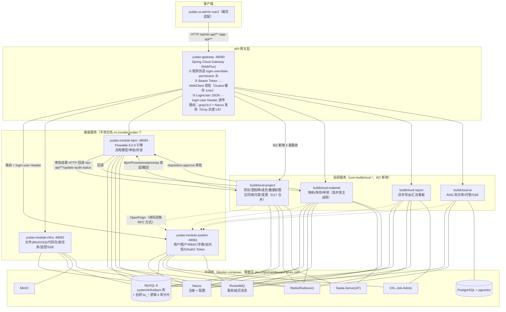
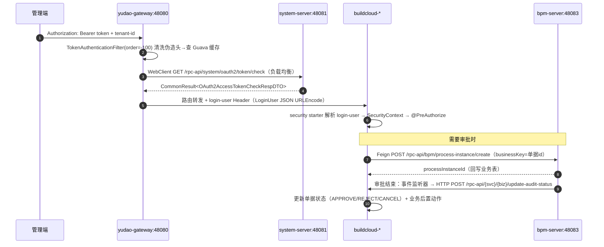

# 架构总览 v0（读码定稿版）

| 项 | 内容 |
| --- | --- |
| 版本 | v0（2026-11-25，W1 Phase 3 产出；W2 裁剪落地后升 v1） |
| 对齐 | spec §3.1 逻辑视图 + §3.2 服务拆分；差异以读码结论标注 |
| 依据 | 四篇读码笔记（gateway / rpc / bpm-integration / starter），全部结论出自 `master-jdk17` 真实源码 |
| 上游基线 | yudao-cloud `master-jdk17`：Spring Boot 3.5.16 / Spring Cloud 2025.0.3 / SC Alibaba 2025.0.0.0 / Flowable 8.0.0 |

## 1. 架构图（Mermaid）

### 关键链路标注（读码确认，非 spec 原文）

## 2. 与 spec §3.1 的逐项核对

| spec §3.1 表述 | 读码结论 | 状态 |
| --- | --- | --- |
| 网关：路由/鉴权/Sentinel 限流 | 路由 ✔（`grayLb://` + Path 断言）；鉴权 = token 校验+透传（权限判断在各服务）；**Sentinel 基座未内置**（BOM 无坐标，仅 script/sentinel 参考文件） | ⚠️ 限流待 W5 按 ADR 引入 |
| 服务间 RPC 方式「以基座默认为准，W1 定稿」 | **定稿：Spring Cloud OpenFeign**（见 ADR-001） | ✔ 本图标注 |
| BPM 工作流（Flowable） | Flowable 8.0.0，业务经 `BpmProcessInstanceApi`（Feign）发起，结果 HTTP 回调 | ✔ |
| 中间件清单 | Nacos/MySQL/Redis/RocketMQ/Seata/XXL-Job/MinIO/PG+pgvector/SkyWalking——基座四服务实际依赖：RocketMQ ✔（mq starter）、XXL-Job ✔（job starter）；**Seata/ShardingSphere 基座 BOM 无坐标，属自研引入（W5/W6 记 ADR）** | ⚠️ 标注来源 |

## 3. 服务端口规划（读码实证 + 自研预留）

| 服务 | 端口 | 来源 |
| --- | --- | --- |
| yudao-gateway | 48080 | application.yaml |
| yudao-module-system | 48081 | application.yaml |
| yudao-module-infra | 48082 | application.yaml |
| yudao-module-bpm | 48083 | application.yaml |
| buildcloud-*（W1 部署文档定稿建议） | 48084-48087 连续段 | spec §3.2「连续端口」约定 |

## 4. 约束（图上不画但必须成立）

1. 自研服务禁止直连基座服务数据库——跨服务数据访问一律走 RPC（读码：基座模块间亦如此，如 bpm→system 走 AdminUserApi）；
2. `/rpc-api/**` 在各服务 SecurityConfiguration 中 permitAll（内网 + 网关剔除伪造头保障），自研服务照抄该模式；
3. 用户上下文（login-user）、租户（tenant-id）、数据权限开关（data-permission-enable）三个 Header 是跨服务传递的三大载体，自研代码不得自行发明；
4. 基座服务保持原样（R-2）：唯一已知例外是 BPM 跨服务回调需要在 bpm-server 新增转发监听器类（新增文件不改旧文件，记 ADR，见 reading-notes-bpm-integration.md §5.2）。
