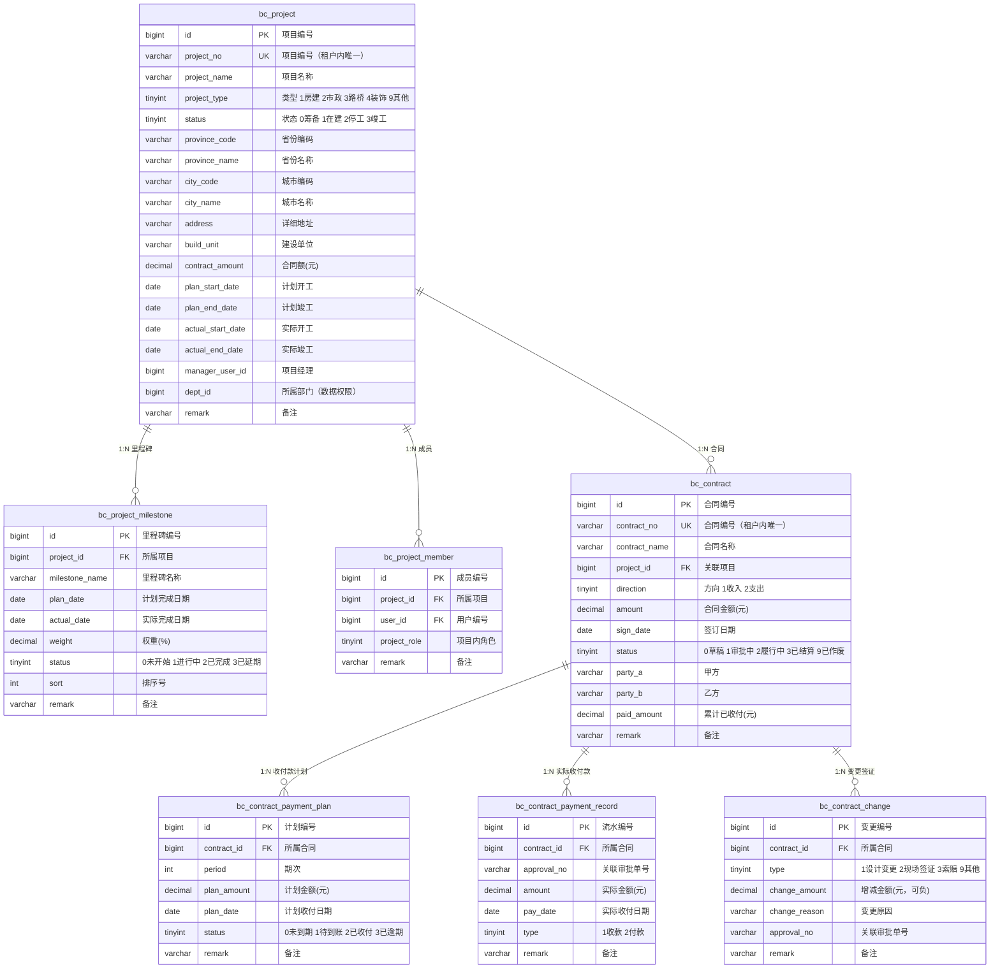

# 项目域 + 合同资金域 ER 图 v0

| 项 | 内容 |
| --- | --- |
| 版本 | v0（2026-11-27，W3 Phase 1 产出；W8 定稿） |
| 对齐 | spec v1.2 §5.1（项目域 + 合同资金域实体）、§7.1（核心表清单：project 3 张 + contract 4 张） |
| 权威来源 | **SQL 为唯一事实来源**：`sql/buildcloud/01-project.sql`（3 张）、`sql/buildcloud/03-contract.sql`（4 张）；本文与 SQL 有出入时以 SQL 为准并回改本文 |
| 通用约定 | 7 张表全部含 BaseDO 六字段 `tenant_id / creator / create_time / updater / update_time / deleted`；引擎 InnoDB；字符集 `utf8mb4` / `utf8mb4_unicode_ci`；金额 `decimal(18,2)`；日期 `date`；DO 一律 `extends TenantBaseDO`（AGENTS R-8） |
| DB 实测 | `bc-mysql:13306` / `ruoyi-vue-pro`，7 张表建表通过，两次执行幂等（证据见 plan-w3-project-contract 进度日志） |

## 1. 实体关系图（Mermaid erDiagram）

## 2. 字段摘要与 spec §5.1 对照

> 图例：✅ = spec 属性已在表中落地。BaseDO 六字段（`tenant_id/creator/create_time/updater/update_time/deleted`）7 张表统一具备，表中不再逐行重复。

### 2.1 `bc_project`（项目主表，spec §5.1 项目实体）

| # | spec §5.1 属性 | 列名 | 类型 | 约束/说明 |
| --- | --- | --- | --- | --- |
| 1 | 编号 | `project_no` | varchar(64) | NOT NULL，`uk_project_no(tenant_id, project_no)` |
| 2 | 名称 | `project_name` | varchar(200) | NOT NULL |
| 3 | 类型 | `project_type` | tinyint | NOT NULL，取值见 `ProjectTypeEnum` |
| 4 | 状态 | `status` | tinyint | NOT NULL DEFAULT 0，`筹备→在建⇄停工→竣工`，见 `ProjectStatusEnum` |
| 5 | 省 | `province_code` / `province_name` | varchar(32/64) | 编码 + 名称快照（infra 无地区表） |
| 6 | 市 | `city_code` / `city_name` | varchar(32/64) | 同上 |
| 7 | 建设单位 | `build_unit` | varchar(200) | 业主 |
| 8 | 合同额 | `contract_amount` | decimal(18,2) | DEFAULT 0.00 |
| 9 | 计划开工 | `plan_start_date` | date | |
| 10 | 计划竣工 | `plan_end_date` | date | |
| 11 | 实际开工 | `actual_start_date` | date | |
| 12 | 实际竣工 | `actual_end_date` | date | |
| 13 | 项目经理 | `manager_user_id` | bigint | `system_users.id`，索引 `idx_manager_user_id` |
| 14 | 所属部门 | `dept_id` | bigint | `system_dept.id`，数据权限按部门过滤，索引 `idx_dept_id` |
| 15 | （补充）详细地址 | `address` | varchar(500) | 工程实体需要的落地地址 |
| 16 | （补充）备注 | `remark` | varchar(500) | |

索引：`uk_project_no` / `idx_dept_id` / `idx_status` / `idx_manager_user_id` / `idx_create_time`。
**结论：spec §5.1 项目实体 14 项属性全部覆盖，无需 `04-project-alter.sql`。**

### 2.2 `bc_project_milestone`（项目里程碑）

| # | spec §5.1 属性 | 列名 | 类型 | 约束/说明 |
| --- | --- | --- | --- | --- |
| 1 | （关联）项目 | `project_id` | bigint | NOT NULL |
| 2 | 名称 | `milestone_name` | varchar(200) | NOT NULL |
| 3 | 计划日期 | `plan_date` | date | |
| 4 | 实际日期 | `actual_date` | date | |
| 5 | 权重 | `weight` | decimal(5,2) | NOT NULL DEFAULT 0.00，百分比 0.00~100.00 |
| 6 | 状态 | `status` | tinyint | 0未开始 1进行中 2已完成 3已延期 |
| 7 | （补充）排序号 | `sort` | int | 甘特图/进度看板展示顺序 |
| 8 | （补充）备注 | `remark` | varchar(500) | |

索引：`idx_project_plan_date(project_id, plan_date)`、`idx_project_status(project_id, status)`。

### 2.3 `bc_project_member`（项目成员）

| # | spec §5.1 属性 | 列名 | 类型 | 约束/说明 |
| --- | --- | --- | --- | --- |
| 1 | 项目 | `project_id` | bigint | NOT NULL |
| 2 | 用户 | `user_id` | bigint | NOT NULL，`system_users.id` |
| 3 | 项目内角色 | `project_role` | tinyint | NOT NULL DEFAULT 9，1项目经理 2技术负责人 3施工员 4安全员 5材料员 9其他 |
| 4 | （补充）备注 | `remark` | varchar(500) | |

索引：`uk_project_user(tenant_id, project_id, user_id)`、`idx_user_id`、`idx_project_role`。
`uk(tenant_id, project_id, user_id)` 是**数据权限第二维度（成员白名单）的前提**：同一用户在同一项目内只能有一个身份，角色变更走 UPDATE。

### 2.4 `bc_contract`（合同主表）

| # | spec §5.1 属性 | 列名 | 类型 | 约束/说明 |
| --- | --- | --- | --- | --- |
| 1 | 编号 | `contract_no` | varchar(64) | NOT NULL，`uk_contract_no(tenant_id, contract_no)` |
| 2 | 名称 | `contract_name` | varchar(200) | NOT NULL |
| 3 | 关联项目 | `project_id` | bigint | 可空（补充协议等可能暂不挂项目），索引 `idx_project_id` |
| 4 | 收入或支出 | `direction` | tinyint | NOT NULL DEFAULT 1，1收入 2支出 |
| 5 | 金额 | `amount` | decimal(18,2) | NOT NULL DEFAULT 0.00 |
| 6 | 签订日期 | `sign_date` | date | |
| 7 | 状态 | `status` | tinyint | 0草稿 1审批中 2履行中 3已结算 9已作废，索引 `idx_status` |
| 8 | （补充）甲方 | `party_a` | varchar(200) | |
| 9 | （补充）乙方 | `party_b` | varchar(200) | |
| 10 | （补充）累计收付 | `paid_amount` | decimal(18,2) | NOT NULL DEFAULT 0.00，进度款审批通过后回写 |
| 11 | （补充）备注 | `remark` | varchar(500) | |

索引：`uk_contract_no` / `idx_project_id` / `idx_status` / `idx_direction_sign_date` / `idx_create_time`。

### 2.5 `bc_contract_payment_plan`（收付款计划）

| # | spec §5.1 属性 | 列名 | 类型 | 约束/说明 |
| --- | --- | --- | --- | --- |
| 1 | （关联）合同 | `contract_id` | bigint | NOT NULL |
| 2 | 期次 | `period` | int | NOT NULL，`uk_contract_period(tenant_id, contract_id, period)` |
| 3 | 计划金额 | `plan_amount` | decimal(18,2) | NOT NULL DEFAULT 0.00 |
| 4 | 计划日期 | `plan_date` | date | |
| 5 | 状态 | `status` | tinyint | 0未到期 1待到账 2已收付 3已逾期，`idx_status_plan_date` 供逾期扫描 Job |
| 6 | （补充）备注 | `remark` | varchar(500) | |

### 2.6 `bc_contract_payment_record`（实际收付款）

| # | spec §5.1 属性 | 列名 | 类型 | 约束/说明 |
| --- | --- | --- | --- | --- |
| 1 | （关联）合同 | `contract_id` | bigint | NOT NULL，索引 `idx_contract_id` |
| 2 | 金额 | `amount` | decimal(18,2) | NOT NULL DEFAULT 0.00 |
| 3 | 日期 | `pay_date` | date | |
| 4 | 关联审批单 | `approval_no` | varchar(64) | 可空（手工补录无审批流），`idx_approval_no` 供回调反查与重复排查 |
| 5 | （补充）类型 | `type` | tinyint | 1收款 2付款 |
| 6 | （补充）备注 | `remark` | varchar(500) | |

### 2.7 `bc_contract_change`（变更签证）

| # | spec §5.1 属性 | 列名 | 类型 | 约束/说明 |
| --- | --- | --- | --- | --- |
| 1 | （关联）合同 | `contract_id` | bigint | NOT NULL，索引 `idx_contract_id` |
| 2 | 类型 | `type` | tinyint | 1设计变更 2现场签证 3索赔 9其他 |
| 3 | 增减金额 | `change_amount` | decimal(18,2) | NOT NULL DEFAULT 0.00，**允许负数** |
| 4 | 原因 | `change_reason` | varchar(500) | |
| 5 | 关联审批 | `approval_no` | varchar(64) | 可空 |
| 6 | （补充）备注 | `remark` | varchar(500) | |

## 3. 设计取舍（为什么这么设计）

### 3.1 `payment_record.approval_no` 存字符串而非 BPM 流程外键

`bc_contract_payment_record.approval_no` 存 **BPM 流程的业务单号**（如 `PAY-20261127-0001`），不是 `bpm_process_instance.id` 或 `bpm_task.id` 外键。三条理由：

1. **可空性**：历史数据与手工补录的收付款没有审批流，硬外键会逼出无意义的占位值（如 `0`），反而让"有无审批单"这一业务语义无法表达；
2. **稳定性**：BPM 实例 id 是引擎内部主键，流程定义升级/实例迁移/数据归档都会变；业务单号是**业务侧生成的稳定幂等键**，回调（spec §5.3）以它反查最可靠；
3. **跨库解耦**：`bc_*` 与 `bpm_*` 同在业务库但分属两个模块，用业务单号关联可避免合同域 DAL 直接依赖 bpm 表结构（AGENTS R-2 精神：不猜、不绑基座内部结构）。

`idx_approval_no` 不是唯一索引——唯一性由业务层「同一审批单只生成一条流水」保证（错误码 `PAYMENT_RECORD_APPROVAL_DUPLICATE`），索引用于排查重复与回调反查。

### 3.2 `change_amount` 允许负数表示减项

`bc_contract_change.change_amount` 用**带符号金额**而非「类型 + 正数金额」：

- 口径统一：`合同变更后金额 = amount + SUM(change_amount)`，SQL 一处聚合即可，不需要 `CASE WHEN type = 减项 THEN -x ELSE x`；
- 避免双字段冗余：若另设 `change_type ∈ {增项, 减项}`，则 `type`（设计变更/签证/索赔）与增减方向是两个正交维度，会退化成两个字段 + 应用层保证一致，容易写出「类型说增、金额为负」的矛盾数据；
- 报表友好：SUM 直接得净变更额，对账页面「原合同额 / 累计变更 / 变更后金额」三列直接可算。

约束：业务层拒绝 `change_amount = 0`（错误码 `CONTRACT_CHANGE_AMOUNT_ZERO`）。

### 3.3 `bc_contract.project_id` 可空，其余子表外键均 NOT NULL

合同允许暂不挂项目（框架协议、补充协议、公司级采购），故 `project_id` 可空；但 `payment_plan / payment_record / change` 一旦存在必然属于某份合同，`contract_id` 一律 NOT NULL——用数据库约束把「孤儿计划/孤儿流水」挡在写入之前。

### 3.4 关联关系不建物理外键（FK）

7 张表之间只有索引、无 `FOREIGN KEY` 约束，与基座 yudao 全库口径一致：

- 逻辑删除（`deleted` bit）与外键的级联语义冲突——FK 不认 `deleted` 标志；
- 分库分表（spec §6.3）与未来服务拆分的迁移成本；
- 引用完整性由 Service 层校验（错误码 `CONTRACT_PROJECT_NOT_EXISTS` 等）+ 对账 Job 兜底。

### 3.5 金额一律 `decimal(18,2)`，日期一律 `date`

- 金额禁止 `double/float`（浮点误差在结算对账中是事故级问题），统一 `decimal(18,2)`，Java 侧对应 `BigDecimal`；
- `date` 而非 `datetime`：合同签订日、计划/实际开竣工、收付款日期都是**业务日历语义**，不关心时分秒；`create_time / update_time` 仍为 `datetime`（审计语义）。

### 3.6 状态字段用 tinyint + 枚举类，不用数据库 enum

- 状态值在 Java 侧集中为枚举（`ProjectStatusEnum`、合同状态同理），禁止魔法数字（AGENTS §4）；
- `tinyint` 便于加状态（如合同旁路 `9-已作废`）而不做 DDL 变更；数据库 `enum` 加值需要 `ALTER TABLE`，且在跨库迁移时兼容性差。

### 3.7 唯一键一律带 `tenant_id`

`uk_project_no` / `uk_contract_no` / `uk_project_user` / `uk_contract_period` 首列都是 `tenant_id`。多租户下"编号唯一"只在租户内成立，不带 `tenant_id` 会让 A 租户占用 B 租户的编号。逻辑删除行不参与唯一性判断由业务层（查重时过滤 `deleted`）保证——MySQL 唯一索引本身不认 `deleted` 标志。

### 3.8 待 W8 定稿时复核的点

| # | 事项 | 说明 |
| --- | --- | --- |
| 1 | `bc_contract_payment_record` 是否需要 `plan_id` | 当前按合同汇总对账（plan 汇总 vs record 汇总）；若录得业务要求"逐期核销"，需加 `plan_id` 表达"这笔款冲哪一期"，届时走 `04-*-alter` 脚本而非改本文件 |
| 2 | `paid_amount` 与 `SUM(record.amount)` 的双写一致性 | 当前设计为审批通过后回写（冗余字段换查询性能）；W5 对账 Job 需校验差异并告警 |
| 3 | `bc_project_member.project_role` 是否独立成字典表 | 当前用 tinyint 常量（5 种角色），若 W3 后角色扩展频繁再抽表 |

## 4. 与 SQL 的一致性

| SQL 文件 | 表 | 建表语句 | 幂等 |
| --- | --- | --- | --- |
| `sql/buildcloud/01-project.sql` | `bc_project`、`bc_project_milestone`、`bc_project_member` | `CREATE TABLE IF NOT EXISTS` | ✅ 重复执行结果一致 |
| `sql/buildcloud/03-contract.sql` | `bc_contract`、`bc_contract_payment_plan`、`bc_contract_payment_record`、`bc_contract_change` | `CREATE TABLE IF NOT EXISTS` | ✅ 重复执行结果一致 |

改表结构时同步三处（AGENTS §4 + `sql/buildcloud/README.md`）：① 建表/变更脚本；② 对应 `dal/dataobject` DO 字段与注释（`extends TenantBaseDO`）；③ 本文 ER 图与字段摘要。
