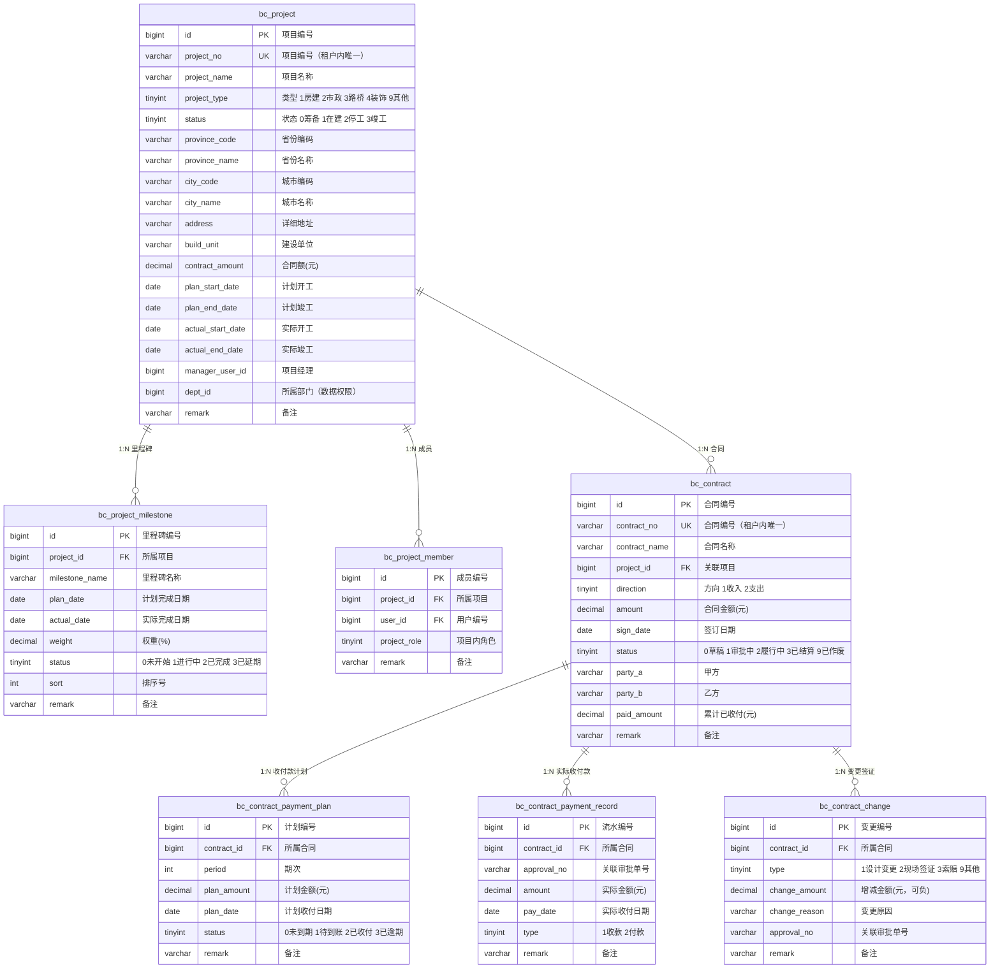
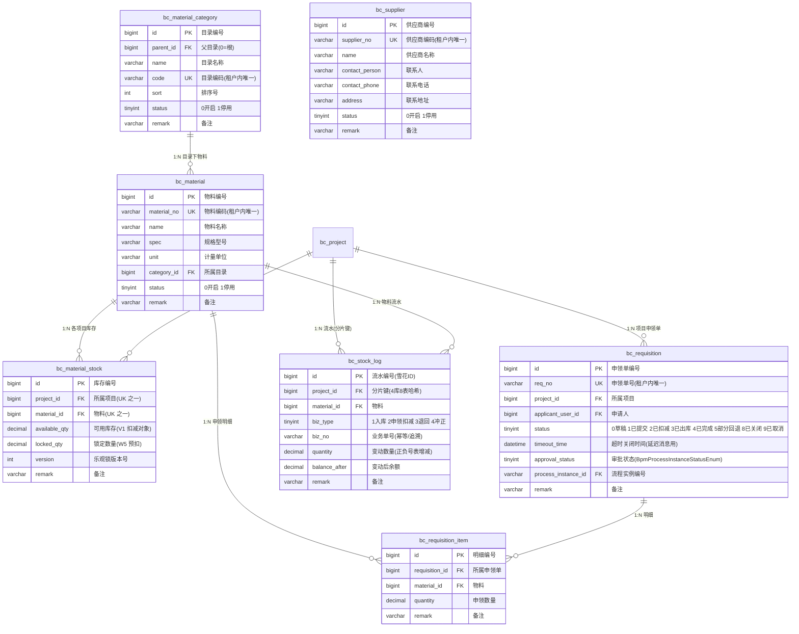

# 项目域 + 合同资金域 + 材料域 ER 图 v0

| 项 | 内容 |
| --- | --- |
| 版本 | v0.1（2026-11-27；v0 由 W3 Phase 1 产出项目域 + 合同资金域 7 张，v0.1 由 W4 Phase 1 追加材料域 7 张；W8 定稿） |
| 对齐 | spec v1.2 §5.1（项目域 + 合同资金域实体）、§5.2（材料域实体）、§6.3（`bc_stock_log` 分库分表）、§7.1（核心表清单：project 3 张 + contract 4 张 + material 7 张） |
| 权威来源 | **SQL 为唯一事实来源**：`sql/buildcloud/01-project.sql`（3 张）、`sql/buildcloud/03-contract.sql`（4 张）、`sql/buildcloud/07-material.sql`（7 张）；本文与 SQL 有出入时以 SQL 为准并回改本文 |
| 通用约定 | **14 张表**全部含 BaseDO 六字段 `tenant_id / creator / create_time / updater / update_time / deleted`；引擎 InnoDB；字符集 `utf8mb4` / `utf8mb4_unicode_ci`；金额 `decimal(18,2)`（材料域无金额列）、材料数量 `decimal(18,4)`；日期 `date`；DO 一律 `extends TenantBaseDO`（AGENTS R-8）；表间只有索引、无物理外键 |
| DB 实测 | `bc-mysql:13306` / `ruoyi-vue-pro`，14 张表建表通过（项目/合同域 7 张 + 材料域 7 张），两次执行幂等（项目域证据见 plan-w3-project-contract 进度日志；材料域证据见 plan-w4-material-v1 Phase 1） |

## 1. 实体关系图（Mermaid erDiagram）

### 1.1 项目域 + 合同资金域（7 张）

### 1.2 材料域（7 张，W4 Phase 1）

## 2. 字段摘要与 spec §5.1 / §5.2 对照

> 图例：✅ = spec 属性已在表中落地。BaseDO 六字段（`tenant_id/creator/create_time/updater/update_time/deleted`）14 张表统一具备，表中不再逐行重复。

### 2.1 `bc_project`（项目主表，spec §5.1 项目实体）

| # | spec §5.1 属性 | 列名 | 类型 | 约束/说明 |
| --- | --- | --- | --- | --- |
| 1 | 编号 | `project_no` | varchar(64) | NOT NULL，`uk_project_no(tenant_id, project_no)` |
| 2 | 名称 | `project_name` | varchar(200) | NOT NULL |
| 3 | 类型 | `project_type` | tinyint | NOT NULL，取值见 `ProjectTypeEnum` |
| 4 | 状态 | `status` | tinyint | NOT NULL DEFAULT 0，`筹备→在建⇄停工→竣工`，见 `ProjectStatusEnum` |
| 5 | 省 | `province_code` / `province_name` | varchar(32/64) | 编码 + 名称快照（infra 无地区表） |
| 6 | 市 | `city_code` / `city_name` | varchar(32/64) | 同上 |
| 7 | 建设单位 | `build_unit` | varchar(200) | 业主 |
| 8 | 合同额 | `contract_amount` | decimal(18,2) | DEFAULT 0.00 |
| 9 | 计划开工 | `plan_start_date` | date | |
| 10 | 计划竣工 | `plan_end_date` | date | |
| 11 | 实际开工 | `actual_start_date` | date | |
| 12 | 实际竣工 | `actual_end_date` | date | |
| 13 | 项目经理 | `manager_user_id` | bigint | `system_users.id`，索引 `idx_manager_user_id` |
| 14 | 所属部门 | `dept_id` | bigint | `system_dept.id`，数据权限按部门过滤，索引 `idx_dept_id` |
| 15 | （补充）详细地址 | `address` | varchar(500) | 工程实体需要的落地地址 |
| 16 | （补充）备注 | `remark` | varchar(500) | |

索引：`uk_project_no` / `idx_dept_id` / `idx_status` / `idx_manager_user_id` / `idx_create_time`。
**结论：spec §5.1 项目实体 14 项属性全部覆盖，无需 `04-project-alter.sql`。**

### 2.2 `bc_project_milestone`（项目里程碑）

| # | spec §5.1 属性 | 列名 | 类型 | 约束/说明 |
| --- | --- | --- | --- | --- |
| 1 | （关联）项目 | `project_id` | bigint | NOT NULL |
| 2 | 名称 | `milestone_name` | varchar(200) | NOT NULL |
| 3 | 计划日期 | `plan_date` | date | |
| 4 | 实际日期 | `actual_date` | date | |
| 5 | 权重 | `weight` | decimal(5,2) | NOT NULL DEFAULT 0.00，百分比 0.00~100.00 |
| 6 | 状态 | `status` | tinyint | 0未开始 1进行中 2已完成 3已延期 |
| 7 | （补充）排序号 | `sort` | int | 甘特图/进度看板展示顺序 |
| 8 | （补充）备注 | `remark` | varchar(500) | |

索引：`idx_project_plan_date(project_id, plan_date)`、`idx_project_status(project_id, status)`。

### 2.3 `bc_project_member`（项目成员）

| # | spec §5.1 属性 | 列名 | 类型 | 约束/说明 |
| --- | --- | --- | --- | --- |
| 1 | 项目 | `project_id` | bigint | NOT NULL |
| 2 | 用户 | `user_id` | bigint | NOT NULL，`system_users.id` |
| 3 | 项目内角色 | `project_role` | tinyint | NOT NULL DEFAULT 9，1项目经理 2技术负责人 3施工员 4安全员 5材料员 9其他 |
| 4 | （补充）备注 | `remark` | varchar(500) | |

索引：`uk_project_user(tenant_id, project_id, user_id)`、`idx_user_id`、`idx_project_role`。
`uk(tenant_id, project_id, user_id)` 是**数据权限第二维度（成员白名单）的前提**：同一用户在同一项目内只能有一个身份，角色变更走 UPDATE。

### 2.4 `bc_contract`（合同主表）

| # | spec §5.1 属性 | 列名 | 类型 | 约束/说明 |
| --- | --- | --- | --- | --- |
| 1 | 编号 | `contract_no` | varchar(64) | NOT NULL，`uk_contract_no(tenant_id, contract_no)` |
| 2 | 名称 | `contract_name` | varchar(200) | NOT NULL |
| 3 | 关联项目 | `project_id` | bigint | 可空（补充协议等可能暂不挂项目），索引 `idx_project_id` |
| 4 | 收入或支出 | `direction` | tinyint | NOT NULL DEFAULT 1，1收入 2支出 |
| 5 | 金额 | `amount` | decimal(18,2) | NOT NULL DEFAULT 0.00 |
| 6 | 签订日期 | `sign_date` | date | |
| 7 | 状态 | `status` | tinyint | 0草稿 1审批中 2履行中 3已结算 9已作废，索引 `idx_status` |
| 8 | （补充）甲方 | `party_a` | varchar(200) | |
| 9 | （补充）乙方 | `party_b` | varchar(200) | |
| 10 | （补充）累计收付 | `paid_amount` | decimal(18,2) | NOT NULL DEFAULT 0.00，进度款审批通过后回写 |
| 11 | （补充）备注 | `remark` | varchar(500) | |

索引：`uk_contract_no` / `idx_project_id` / `idx_status` / `idx_direction_sign_date` / `idx_create_time`。

### 2.5 `bc_contract_payment_plan`（收付款计划）

| # | spec §5.1 属性 | 列名 | 类型 | 约束/说明 |
| --- | --- | --- | --- | --- |
| 1 | （关联）合同 | `contract_id` | bigint | NOT NULL |
| 2 | 期次 | `period` | int | NOT NULL，`uk_contract_period(tenant_id, contract_id, period)` |
| 3 | 计划金额 | `plan_amount` | decimal(18,2) | NOT NULL DEFAULT 0.00 |
| 4 | 计划日期 | `plan_date` | date | |
| 5 | 状态 | `status` | tinyint | 0未到期 1待到账 2已收付 3已逾期，`idx_status_plan_date` 供逾期扫描 Job |
| 6 | （补充）备注 | `remark` | varchar(500) | |

### 2.6 `bc_contract_payment_record`（实际收付款）

| # | spec §5.1 属性 | 列名 | 类型 | 约束/说明 |
| --- | --- | --- | --- | --- |
| 1 | （关联）合同 | `contract_id` | bigint | NOT NULL，索引 `idx_contract_id` |
| 2 | 金额 | `amount` | decimal(18,2) | NOT NULL DEFAULT 0.00 |
| 3 | 日期 | `pay_date` | date | |
| 4 | 关联审批单 | `approval_no` | varchar(64) | 可空（手工补录无审批流），`idx_approval_no` 供回调反查与重复排查 |
| 5 | （补充）类型 | `type` | tinyint | 1收款 2付款 |
| 6 | （补充）备注 | `remark` | varchar(500) | |

### 2.7 `bc_contract_change`（变更签证）

| # | spec §5.1 属性 | 列名 | 类型 | 约束/说明 |
| --- | --- | --- | --- | --- |
| 1 | （关联）合同 | `contract_id` | bigint | NOT NULL，索引 `idx_contract_id` |
| 2 | 类型 | `type` | tinyint | 1设计变更 2现场签证 3索赔 9其他 |
| 3 | 增减金额 | `change_amount` | decimal(18,2) | NOT NULL DEFAULT 0.00，**允许负数** |
| 4 | 原因 | `change_reason` | varchar(500) | |
| 5 | 关联审批 | `approval_no` | varchar(64) | 可空 |
| 6 | （补充）备注 | `remark` | varchar(500) | |

### 2.8 `bc_material_category`（材料目录，spec §5.2「树形目录」）

| # | spec §5.2 属性 | 列名 | 类型 | 约束/说明 |
| --- | --- | --- | --- | --- |
| 1 | 树形目录（父节点） | `parent_id` | bigint | NOT NULL DEFAULT 0，`0` 表示根节点，索引 `idx_parent_id` |
| 2 | （目录名称） | `name` | varchar(100) | NOT NULL，同级下建议不重名（业务层校验） |
| 3 | （目录编码） | `code` | varchar(64) | NOT NULL，`uk_material_category_code(tenant_id, code)` |
| 4 | （补充）排序号 | `sort` | int | NOT NULL DEFAULT 0，同级内升序 |
| 5 | （补充）状态 | `status` | tinyint | NOT NULL DEFAULT 0，0开启 1停用（`CommonStatusEnum`） |
| 6 | （补充）备注 | `remark` | varchar(500) | |

索引：`uk_material_category_code` / `idx_parent_id`。删除前校验无子节点（错误码 `MATERIAL_CATEGORY_HAS_CHILDREN`）。

### 2.9 `bc_material`（物料，spec §5.2）

| # | spec §5.2 属性 | 列名 | 类型 | 约束/说明 |
| --- | --- | --- | --- | --- |
| 1 | 编码 | `material_no` | varchar(64) | NOT NULL，`uk_material_no(tenant_id, material_no)` |
| 2 | 名称 | `name` | varchar(200) | NOT NULL，索引 `idx_name` |
| 3 | 规格 | `spec` | varchar(200) | 可空，如 `HRB400 Φ20` |
| 4 | 单位 | `unit` | varchar(32) | NOT NULL（个/吨/米/立方；存名称快照，不设单位字典表——spec 未要求） |
| 5 | 目录 | `category_id` | bigint | 可空，逻辑关联 `bc_material_category.id`，索引 `idx_category_id` |
| 6 | （补充）状态 | `status` | tinyint | NOT NULL DEFAULT 0，0开启 1停用（停用后不可申领） |
| 7 | （补充）备注 | `remark` | varchar(500) | |

索引：`uk_material_no` / `idx_category_id` / `idx_name`。**spec §5.2 物料 5 项属性全部覆盖**。

### 2.10 `bc_supplier`（供应商，spec §5.2）

| # | spec §5.2 属性 | 列名 | 类型 | 约束/说明 |
| --- | --- | --- | --- | --- |
| 1 | （供应商编码） | `supplier_no` | varchar(64) | NOT NULL，`uk_supplier_no(tenant_id, supplier_no)` |
| 2 | （供应商名称） | `name` | varchar(200) | NOT NULL，索引 `idx_name` |
| 3 | （联系人） | `contact_person` | varchar(64) | 可空 |
| 4 | （联系电话） | `contact_phone` | varchar(32) | 可空 |
| 5 | （地址） | `address` | varchar(500) | 可空 |
| 6 | （补充）状态 | `status` | tinyint | NOT NULL DEFAULT 0 |
| 7 | （补充）备注 | `remark` | varchar(500) | |

索引：`uk_supplier_no` / `idx_name`。spec §5.2 对供应商只给了实体名、未逐列列出，故按「编码 + 名称 + 联系方式 + 地址」这一建筑业供应商台账最小可用集落地。

### 2.11 `bc_material_stock`（项目库存，spec §5.2 核心表）

| # | spec §5.2 属性 | 列名 | 类型 | 约束/说明 |
| --- | --- | --- | --- | --- |
| 1 | 项目 | `project_id` | bigint | NOT NULL，`uk_project_material` 第 2 列 |
| 2 | 物料 | `material_id` | bigint | NOT NULL，`uk_project_material` 第 3 列，索引 `idx_material_id` |
| 3 | `available_qty` | `available_qty` | decimal(18,4) | NOT NULL DEFAULT 0.0000，**V1 扣减对象** |
| 4 | `locked_qty` | `locked_qty` | decimal(18,4) | NOT NULL DEFAULT 0.0000，W5 预扣预留量 |
| 5 | `version` 乐观锁 | `version` | int | NOT NULL DEFAULT 0，MyBatis Plus `@Version` |
| 6 | （补充）备注 | `remark` | varchar(500) | |

索引：**`uk_project_material(tenant_id, project_id, material_id)`** + `idx_material_id`。
`uk_project_material` 是「同项目同物料唯一」的数据库级保证，也是 W5 并发热点行的前提（见 §3.11）。

### 2.12 `bc_requisition`（材料申领单，spec §5.2）

| # | spec §5.2 属性 | 列名 | 类型 | 约束/说明 |
| --- | --- | --- | --- | --- |
| 1 | `req_no` 全局唯一 | `req_no` | varchar(64) | NOT NULL，`uk_req_no(tenant_id, req_no)`；MQ 消费幂等键（§6.1） |
| 2 | 项目 | `project_id` | bigint | NOT NULL，索引 `idx_project_id` |
| 3 | 申请人 | `applicant_user_id` | bigint | NOT NULL，`system_users.id` |
| 4 | 状态 | `status` | tinyint | NOT NULL DEFAULT 0，0草稿 1已提交(已预扣) 2已扣减 3已出库 4已完成 5部分回退 8已关闭 9已取消 |
| 5 | 超时时间 | `timeout_time` | datetime | 可空，提交时 = now + 30min，W5 延迟消息据此关单 |
| 6 | 审批状态 | `approval_status` | tinyint | NOT NULL DEFAULT -1，复用 `BpmProcessInstanceStatusEnum` 值域 |
| 7 | 流程实例 | `process_instance_id` | varchar(64) | 可空，`ACT_HI_PROCINST.PROC_INST_ID_` |
| 8 | （补充）备注 | `remark` | varchar(500) | |

索引：`uk_req_no` / `idx_project_id` / `idx_status` / `idx_create_time` / `idx_status_timeout(status, timeout_time)`。
`idx_status_timeout` 是超时关单 Job 与延迟消息的主路径（避免全表扫待办）。

### 2.13 `bc_requisition_item`（申领明细，spec §5.2）

| # | spec §5.2 属性 | 列名 | 类型 | 约束/说明 |
| --- | --- | --- | --- | --- |
| 1 | 申领单 | `requisition_id` | bigint | NOT NULL，索引 `idx_requisition_id` |
| 2 | 物料 | `material_id` | bigint | NOT NULL，索引 `idx_material_id` |
| 3 | 数量 | `quantity` | decimal(18,4) | NOT NULL DEFAULT 0.0000，与库存同精度（避免累加漂移） |
| 4 | （补充）备注 | `remark` | varchar(500) | |

### 2.14 `bc_stock_log`（库存流水，spec §5.2 + §6.3 分片主表）

| # | spec §5.2 属性 | 列名 | 类型 | 约束/说明 |
| --- | --- | --- | --- | --- |
| 1 | （关联）项目 | `project_id` | bigint | NOT NULL，**分片键**（§6.3：4 库 8 表按此哈希），`idx_project_create` 首列 |
| 2 | （关联）物料 | `material_id` | bigint | NOT NULL |
| 3 | `biz_type` | `biz_type` | tinyint | NOT NULL，1入库 2申领扣减 3退回 4冲正 |
| 4 | `biz_no` | `biz_no` | varchar(64) | 可空（历史/手工调账可能无单号），`idx_project_biz` 第 2 列 |
| 5 | 数量± | `quantity` | decimal(18,4) | NOT NULL，**正负号表增减** |
| 6 | 变动后余额 | `balance_after` | decimal(18,4) | NOT NULL DEFAULT 0.0000 |
| 7 | （补充）备注 | `remark` | varchar(500) | |

索引：**`idx_project_create(project_id, create_time)`**（分片查询主路径，必须建）+ `idx_project_biz(project_id, biz_no)`。
`id` 分片后由雪花算法（MyBatis Plus `ASSIGN_ID`）生成，不用自增（§6.3）。

## 3. 设计取舍（为什么这么设计）

> 3.1–3.8 为项目域 / 合同资金域（W3 产出），3.9–3.14 为材料域（W4 产出）。

### 3.1 `payment_record.approval_no` 存字符串而非 BPM 流程外键

`bc_contract_payment_record.approval_no` 存 **BPM 流程的业务单号**（如 `PAY-20261127-0001`），不是 `bpm_process_instance.id` 或 `bpm_task.id` 外键。三条理由：

1. **可空性**：历史数据与手工补录的收付款没有审批流，硬外键会逼出无意义的占位值（如 `0`），反而让"有无审批单"这一业务语义无法表达；
2. **稳定性**：BPM 实例 id 是引擎内部主键，流程定义升级/实例迁移/数据归档都会变；业务单号是**业务侧生成的稳定幂等键**，回调（spec §5.3）以它反查最可靠；
3. **跨库解耦**：`bc_*` 与 `bpm_*` 同在业务库但分属两个模块，用业务单号关联可避免合同域 DAL 直接依赖 bpm 表结构（AGENTS R-2 精神：不猜、不绑基座内部结构）。

`idx_approval_no` 不是唯一索引——唯一性由业务层「同一审批单只生成一条流水」保证（错误码 `PAYMENT_RECORD_APPROVAL_DUPLICATE`），索引用于排查重复与回调反查。

### 3.2 `change_amount` 允许负数表示减项

`bc_contract_change.change_amount` 用**带符号金额**而非「类型 + 正数金额」：

- 口径统一：`合同变更后金额 = amount + SUM(change_amount)`，SQL 一处聚合即可，不需要 `CASE WHEN type = 减项 THEN -x ELSE x`；
- 避免双字段冗余：若另设 `change_type ∈ {增项, 减项}`，则 `type`（设计变更/签证/索赔）与增减方向是两个正交维度，会退化成两个字段 + 应用层保证一致，容易写出「类型说增、金额为负」的矛盾数据；
- 报表友好：SUM 直接得净变更额，对账页面「原合同额 / 累计变更 / 变更后金额」三列直接可算。

约束：业务层拒绝 `change_amount = 0`（错误码 `CONTRACT_CHANGE_AMOUNT_ZERO`）。

### 3.3 `bc_contract.project_id` 可空，其余子表外键均 NOT NULL

合同允许暂不挂项目（框架协议、补充协议、公司级采购），故 `project_id` 可空；但 `payment_plan / payment_record / change` 一旦存在必然属于某份合同，`contract_id` 一律 NOT NULL——用数据库约束把「孤儿计划/孤儿流水」挡在写入之前。

### 3.4 关联关系不建物理外键（FK）

7 张表之间只有索引、无 `FOREIGN KEY` 约束，与基座 yudao 全库口径一致（材料域同理，理由另见 §3.12）：

- 逻辑删除（`deleted` bit）与外键的级联语义冲突——FK 不认 `deleted` 标志；
- 分库分表（spec §6.3）与未来服务拆分的迁移成本；
- 引用完整性由 Service 层校验（错误码 `CONTRACT_PROJECT_NOT_EXISTS` 等）+ 对账 Job 兜底。

### 3.5 金额一律 `decimal(18,2)`，日期一律 `date`

- 金额禁止 `double/float`（浮点误差在结算对账中是事故级问题），统一 `decimal(18,2)`，Java 侧对应 `BigDecimal`；
- `date` 而非 `datetime`：合同签订日、计划/实际开竣工、收付款日期都是**业务日历语义**，不关心时分秒；`create_time / update_time` 仍为 `datetime`（审计语义）。

### 3.6 状态字段用 tinyint + 枚举类，不用数据库 enum

- 状态值在 Java 侧集中为枚举（`ProjectStatusEnum`、合同状态同理），禁止魔法数字（AGENTS §4）；
- `tinyint` 便于加状态（如合同旁路 `9-已作废`）而不做 DDL 变更；数据库 `enum` 加值需要 `ALTER TABLE`，且在跨库迁移时兼容性差。

### 3.7 唯一键一律带 `tenant_id`

`uk_project_no` / `uk_contract_no` / `uk_project_user` / `uk_contract_period` 首列都是 `tenant_id`。多租户下"编号唯一"只在租户内成立，不带 `tenant_id` 会让 A 租户占用 B 租户的编号。逻辑删除行不参与唯一性判断由业务层（查重时过滤 `deleted`）保证——MySQL 唯一索引本身不认 `deleted` 标志。

### 3.8 待 W8 定稿时复核的点

| # | 事项 | 说明 |
| --- | --- | --- |
| 1 | `bc_contract_payment_record` 是否需要 `plan_id` | 当前按合同汇总对账（plan 汇总 vs record 汇总）；若录得业务要求"逐期核销"，需加 `plan_id` 表达"这笔款冲哪一期"，届时走 `04-*-alter` 脚本而非改本文件 |
| 2 | `paid_amount` 与 `SUM(record.amount)` 的双写一致性 | 当前设计为审批通过后回写（冗余字段换查询性能）；W5 对账 Job 需校验差异并告警 |
| 3 | `bc_project_member.project_role` 是否独立成字典表 | 当前用 tinyint 常量（5 种角色），若 W3 后角色扩展频繁再抽表 |

### 3.9 材料域：`bc_stock_log` 为什么用 `project_id` 做分片键

spec §6.3 定的是按 `project_id` 哈希 → 逻辑 4 库 × 每库 8 表 = 32 分片。选择 `project_id` 而不是 `material_id` / `create_time`，理由在**业务查询形态**：

1. **查询天然带 project_id**：流水查询入口只有两个——项目详情页的「本项目材料流水」，以及数据权限过滤后的列表（AGENTS/spec §5.1 的数据权限按部门 + 项目成员白名单）。`WHERE project_id = ?` 是每次请求都有的谓词，**单分片路由，零跨片归并**；
2. **写路径同样带 project_id**：入库/申领扣减/退回/冲正必然知道发生在哪个项目（`bc_material_stock` 本身就是 `project_id + material_id` 维度），写路由不产生广播；
3. **避免跨片**：若按 `material_id` 分片，则「某项目的材料消耗汇总」必须打在全部 32 片上再归并，且该查询是报表域（spec §5.4「材料消耗汇总」）的核心路径——正好是分片最怕的场景；
4. **代价与兜底**（面试要讲清取舍）：「全租户某物料的历史流转」这类不带 project_id 的全局查询会跨片。处理方式是 spec §6.3 明确的——走异步分片并行查 + 归并（报表 Job 场景），或接口上要求必须带项目条件。**不是所有查询都免跨片，而是把最热的路径做到零跨片。**

`idx_project_create(project_id, create_time)` 因此不是可选优化：分片键定位到片之后，片内要靠它做时间范围扫，否则每个分片内都是全片扫描。同理 `idx_project_biz(project_id, biz_no)` 也以分片键打头，保证「按业务单号反查流水（含冲正）」不跨片。

### 3.10 材料域：`available_qty` / `locked_qty` 拆分 vs 单一 `quantity`

没有用单列 `quantity`，而是拆成「可用 + 锁定」两列：

- **预扣语义需要三个量而不是一个**：真实库存 = `available_qty + locked_qty`；「可被新申领看到的」只有 `available_qty`。若只有一列 `quantity`，提交申领后立刻扣减它，则在「提交 → 审批」这段窗口里，审批驳回和超时关单都必须把量加回来——**加回来之前的窗口内库存是虚低的**，前端会看到「明明有货却申领不了」；
- **锁定列是 W5 的实现位（V1 先留列不用）**：V1 走 spec §6.1 的同步链路，`SELECT ... FOR UPDATE` 直接扣 `available_qty`，`locked_qty` 恒为 0；W5 的 Redis Lua 预扣 + MQ 异步落库链路会把 `locked_qty` 用起来（预扣计入 locked，审批通过后 locked → 实际扣减）。**现在就把列建出来**，是为了 W5 不需要对热点主表做 `ALTER`——在百万级流水表上线后改结构，风险远高于建表时留一列；
- **对账口径明确**：spec §6.1 第 ⑦ 步对账是「Redis 预扣 vs DB 流水」，落库口径即 `available_qty + locked_qty` 与 `SUM(stock_log.quantity)` 的一致性，两列拆分让「可用与锁定各自对得上」成为可独立校验的断言。

### 3.11 材料域：`quantity` 用正负号 vs 拆 in/out 两列

`bc_stock_log.quantity` 用**带符号数量**（入库/退回/冲正为正，申领扣减为负），不拆 `in_qty` / `out_qty`：

- **对账一行聚合**：某项目某物料的净变动 = `SUM(quantity)`，一处聚合搞定。拆两列则每条对账 SQL 都要写 `SUM(in_qty) - SUM(out_qty)`，且任何一处漏写减号都会静默出错；
- **`balance_after` 可以逐行递推校验**：`本行 balance_after = 上一行 balance_after + 本行 quantity`，正向反向都能验。拆两列则「这一笔到底是加还是减」要靠 `biz_type` 再判断一次，等于把符号信息编码进了另一个字段，容易出现「biz_type=扣减但 out_qty=0」的矛盾数据；
- **与 `bc_contract_change.change_amount` 同一套口径**：项目域已经用带符号金额表达增减（本文 §3.2），材料域沿用同一思路，减少跨域阅读成本；
- 约束：`biz_type` 与 `quantity` 的符号必须一致，由 Service 层统一收口构造流水（不让调用方自己填符号）。

### 3.12 材料域：为什么不建物理外键

与项目域同理（见 §3.4），7 张材料表之间只有索引、无 `FOREIGN KEY`：

- 逻辑删除（`deleted` bit）与外键级联语义冲突——FK 不认 `deleted` 标志，删父记录会被 FK 拦住，而业务上"删除"只是打标记；
- **分库分表直接否决外键**：`bc_stock_log` 在 W6 会被拆到 4 库 8 表（§6.3），分片表上的外键在 MySQL 中无法跨库建立，`bc_stock_log → bc_project` 的外键在分片后必然要拆掉。与其上线前建、上线后拆，不如从建表就不建；
- 引用完整性由 Service 层校验（错误码 `MATERIAL_NOT_EXISTS` / `STOCK_NOT_EXISTS` / `MATERIAL_CATEGORY_HAS_CHILDREN` 等）+ 对账 Job 兜底。

### 3.13 材料域：数量列为什么是 `decimal(18,4)`

材料会按吨、立方、米计量，天然带小数；与项目域金额 `decimal(18,2)` 不同，**数量比金额多留 2 位小数**：

- 明细 `bc_requisition_item.quantity`、库存 `available_qty/locked_qty`、流水 `quantity/balance_after` 全是 `decimal(18,4)`，**同一精度**。若明细 4 位、库存 2 位，则「多行明细累加 vs 库存扣减」在对账时会因四舍五入产生几分钱的漂移，而这类差异在百万行流水里极难定位；
- 禁止 `double/float`：同 §3.5 的浮点误差理由，且 `SUM` 聚合的误差会随行数累积；
- 材料域**无金额列**：材料金额属报表域聚合口径（spec §5.4），不在本域建冗余金额字段。

### 3.14 待 W4-W6 复核的点（材料域）

| # | 事项 | 说明 |
| --- | --- | --- |
| 1 | `bc_requisition_item` 是否需要 `supplier_id` | spec §5.2 明细只列「申领单/物料/数量」；若 W5 退料需按供应商溯源，届时走 alter 脚本 |
| 2 | `bc_material_stock` 是否需要 `project_id` 之外的成本维度 | 当前 `uk(tenant_id, project_id, material_id)` 不支持「同项目同物料多批次/多仓库」，若 W6 需要批次追溯须加 `batch_no` 并改唯一键（届时走 alter，不改本文件） |
| 3 | `bc_stock_log.biz_no` 是否升级为唯一索引 | 当前非唯一（一次申领可产生扣减 + 冲正多条流水）；W5 若改为「一 biz_no 一流水」需评估幂等键设计 |

## 4. 与 SQL 的一致性

| SQL 文件 | 表 | 建表语句 | 幂等 |
| --- | --- | --- | --- |
| `sql/buildcloud/01-project.sql` | `bc_project`、`bc_project_milestone`、`bc_project_member` | `CREATE TABLE IF NOT EXISTS` | ✅ 重复执行结果一致 |
| `sql/buildcloud/03-contract.sql` | `bc_contract`、`bc_contract_payment_plan`、`bc_contract_payment_record`、`bc_contract_change` | `CREATE TABLE IF NOT EXISTS` | ✅ 重复执行结果一致 |
| `sql/buildcloud/07-material.sql` | `bc_material_category`、`bc_material`、`bc_supplier`、`bc_material_stock`、`bc_requisition`、`bc_requisition_item`、`bc_stock_log` | `CREATE TABLE IF NOT EXISTS` | ✅ 重复执行结果一致（W4 Phase 1 实测两次，表数 7→14 后不再变化） |

改表结构时同步三处（AGENTS §4 + `sql/buildcloud/README.md`）：① 建表/变更脚本；② 对应 `dal/dataobject` DO 字段与注释（`extends TenantBaseDO`）；③ 本文 ER 图与字段摘要。
